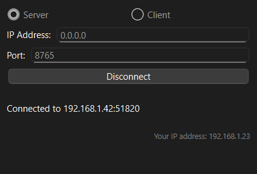

# ClipSync

Copy text on one computer and paste it on another. ClipSync keeps the clipboards of two computers on the same network in sync, in both directions, across Windows and macOS.



## Features

- **Two-way sync** of copied text between two computers
- **Desktop app** (PyQt6): choose server or client, see your IP address, connect and disconnect
- **Terminal version** for a lightweight, headless setup
- **Windows executable**, no Python needed
- Unicode text supported

## How it works

One computer runs as the **server** and waits for a connection; the other connects to it as the **client**. Once connected, both sides run the same two loops over a single TCP socket:

- **Send loop**: checks the local clipboard every 250 ms and sends new text.
- **Receive loop**: writes incoming text to the local clipboard.

Each message is length-prefixed (a 4-byte size followed by the UTF-8 text), so text of any length arrives intact. Text received from the other computer is remembered as already synced and never sent back. Without that, the echo of an older copy could overwrite something you just copied.

## Download

Get **`ClipSync.exe`** from the [latest release](../../releases/latest) (Windows).

## Usage

### Desktop app

```bash
pip install -r requirements.txt
python clip_sync_gui.py
```

1. On the first computer, select **Server**, keep `0.0.0.0`, and click **Connect**. Note the IP address shown at the bottom right.
2. On the second computer, select **Client**, enter that IP address and the same port, and click **Connect**.

### Terminal

```bash
pip install pyperclip

python clip_sync.py server 0.0.0.0 8765       # first computer
python clip_sync.py client 192.168.1.23 8765  # second computer, with the server's IP
```

If the computers can't connect, allow the port (default `8765`) through the server's firewall.

## Security

ClipSync is meant for a trusted home network. The connection is **not encrypted or authenticated**: anyone on the same network who connects to the server first receives everything you copy, including passwords. Don't run it on public or shared Wi-Fi.

## Build the executable

On Windows:

```bash
build_windows.bat
```

It installs the dependencies, builds `dist/ClipSync.exe` with PyInstaller using [`clip_sync.spec`](clip_sync.spec), and zips it.

## License

[MIT](LICENSE)
